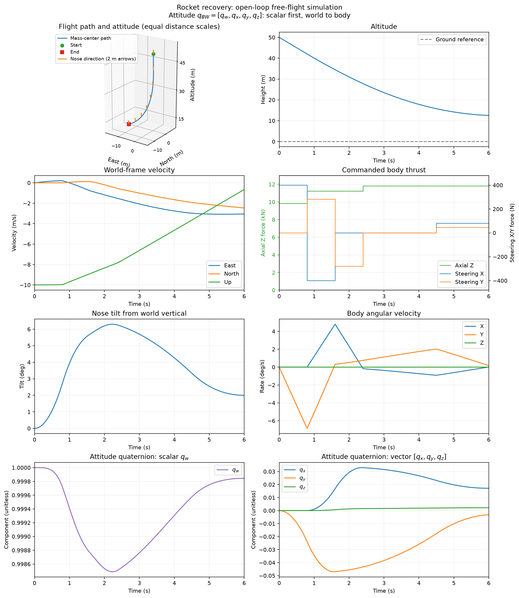

# Rocket Recovery Dynamics

A six-degree-of-freedom rocket plant for studying terminal descent and recovery
landing. The model combines gravity, aerodynamics, and abstract thrust, with
quaternion attitude and a three-component angular velocity. It provides
nonlinear simulation and local linearizations for future trajectory optimization.

The rocket implementation is the plant and simulation layer. It has no rocket
controller or iLQR/AL-iLQR solver. The original pendulum optimization example is
preserved separately in [the pendulum documentation](docs/pendulum/README.md).

## Run a descent segment

Use Python 3.10 or newer. From the repository root:

```bash
python3 -m venv .venv
.venv/bin/python -m pip install ".[plot,dev]"
.venv/bin/python -m rocket_landing
```

These commands install the local package and use the same Python interpreter to
run it. The distribution is named `rocket-recovery-dynamics`; its Python import
is `rocket_landing`. NumPy is the only required runtime dependency. Matplotlib
and the development tools are optional extras.

The default `maneuver` example propagates six seconds at a 0.02 s time step.
It starts upright at 50 m altitude, descending at 10 m/s, with a mass of 1000 kg.
Five preset thrust phases tip the vehicle in two axes, counter the rotation,
and brake its descent. Thrust at the tail produces both force and torque;
the changing attitude redirects axial thrust into lateral motion.

The rocket moves about 10.6 m west and 6.1 m south while descending to 12.5 m.
Descent speed falls to about 0.66 m/s; tilt peaks at 6.3° and ends at 2.0°,
with a final angular speed of 0.16°/s. All commands are fixed before simulation,
with no feedback or optimizer. The segment ends above ground with lateral
velocity remaining. The [model notes](docs/rocket-model.md#simulation-example)
give the exact thrust schedule.

The default command prints a summary and writes no files. To export a trajectory,
figure, and local state/control matrices:

```bash
.venv/bin/python -m rocket_landing \
  --output-dir outputs/rocket \
  --plot outputs/rocket/maneuver.png \
  --linearize
```

The output directory contains `trajectory.csv`, `summary.json`, and, when
`--linearize` is supplied, `linearizations.npz`. The summary records the complete
thrust schedule and the peak/final tilt and angular speed. The figure includes
a 3D trajectory with nose-direction arrows, thrust, altitude, velocity, tilt,
angular rates, and all four scalar-first attitude quaternion components
`[qw, qx, qy, qz]`. Separate scalar/vector quaternion panels make small attitude
changes readable. Add `--show` to display the figure interactively.



Use `--scenario braking` for the original four-second vertical braking case,
`--scenario hover` for stationary thrust balance, or `--scenario coast` for
unpowered descent. All scenarios use the free-flight plant; they do not
simulate ground contact.

## Plant interface

World coordinates are local East-North-Up, with world +Z upward. Body +Z points
toward the nose. Position and velocity are expressed in the world frame;
angular velocity and thrust are expressed in the body frame.

| Quantity | Layout | Units |
| --- | --- | --- |
| Stored state, 14 entries | `[r_W(3), v_W(3), q_BW(4), omega_B(3), m]` | m, m/s, unit quaternion, rad/s, kg |
| Control, 3 entries | `[T_Bx, T_By, T_Bz]` | N |
| Local perturbation, 13 entries | `[dr_W(3), dv_W(3), dphi_B(3), domega_B(3), dm]` | m, m/s, rad, rad/s, kg |

Attitude uses the **left, passive, scalar-first** convention: `q = [s, v]`,
`C_BW(q)` maps world vectors into body coordinates, and
`q_dot = 0.5 * [0, omega_B] ⊗L q`. The left product has a negative cross term.
The [model notes](docs/rocket-model.md) define the multiplication, rotation
matrix, load equations, and local attitude coordinates explicitly.

```python
import numpy as np

from rocket_landing import (
    RocketLandingPlant,
    linearize_trajectory,
    make_state,
    rollout,
)

plant = RocketLandingPlant()
x0 = make_state()  # 30 m altitude, -10 m/s vertical velocity, 1000 kg
thrust = np.array([0.0, 0.0, x0[13] * (plant.parameters.gravity + 2.0)])
controls = np.tile(thrust, (200, 1))
states = rollout(plant, x0, controls, dt=0.02)
A, B = linearize_trajectory(plant, states, controls, dt=0.02)

assert states.shape == (201, 14)
assert A.shape == (200, 13, 13)
assert B.shape == (200, 13, 3)
```

`plant.loads(x, u)` exposes each force and moment, `plant.derivative(x, u)`
returns continuous dynamics, and `plant.step(x, u, dt)` advances held thrust
using RK4 with quaternion normalization. Mass is fixed by default. Setting
`RocketParameters(specific_impulse=...)` enables algebraic mass depletion
without adding an engine state.

Continuous Jacobians use the 14 stored coordinates. Discrete Jacobians use
13 local coordinates, including a three-component attitude error. Both are
computed numerically with central differences. `linearize_trajectory` requires
a dynamically consistent rollout and returns matrices ready for a future
solver's local trajectory model. At zero thrust, optional mass depletion is
nondifferentiable and the Jacobian methods reject that operating point.

## Repository layout

```text
src/
    rocket_landing/
        attitude.py          Quaternion algebra and local state coordinates
        dynamics.py          Loads, rigid-body plant, RK4, Jacobians
        simulation.py        Open-loop rollout and trajectory linearizations
        demo.py              Command-line scenarios and result exports
        plotting.py          Optional simulation figures
    pendulum_ilqr/
        plants/pendulum.py   Existing pendulum model
        controls/ilqr.py     Existing pendulum iLQR and AL-iLQR
        simulation/          Pendulum demo, exports, and plotting
tests/                       Plant, quaternion, simulation, and pendulum tests
docs/
    rocket-model.md          Rocket conventions, equations, and assumptions
    pendulum/                Original optimization notes and reference results
```

The rocket plant does not import the pendulum solvers. This separation lets a
future controls layer consume the rocket's dynamics and linearizations without
moving propagation or load calculations into the optimizer.

## Validation

These checks exercise the installed package. Reinstall after changing source
files so the test run uses the updated code:

```bash
.venv/bin/python -m pip install ".[plot,dev]"
.venv/bin/python -m pytest
.venv/bin/ruff check .
.venv/bin/ruff format --check .
.venv/bin/python -m build
```

Tests cover quaternion algebra and rate signs, force and moment accounting,
known free-flight cases, mass depletion, integration, and the local
linearization interface. Maneuver checks bound tilt and angular rates, verify
continued descent above ground, and remove steering/thrust to confirm their
effects on rotation, translation, and braking. The retained pendulum tests
exercise its existing optimization and export behavior.

## Modeling scope

Vehicle dimensions, inertia, drag-area products, and atmospheric defaults are
illustrative values. They are not identified from or validated against a
particular rocket. The aerodynamic model is a lumped anisotropic drag force at
a fixed pressure center, including the local velocity caused by body rotation.
Gravity is constant in a local world frame; wind is uniform and density follows
an exponential profile.

Thrust is a directly commanded body force at a fixed application point. The
plant has no throttle or gimbal dynamics, thrust limits, ground contact,
clipping, state estimator, or controller. Inertia and load offsets remain fixed
even when mass depletion is enabled. These assumptions and the finite-difference
linearization limits are detailed in [the model notes](docs/rocket-model.md).
