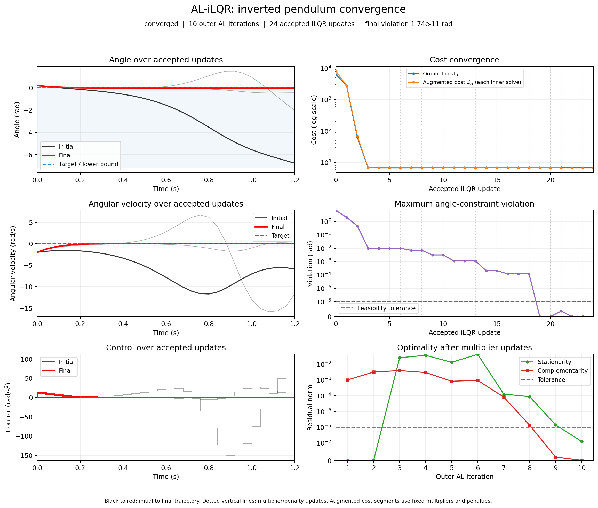

# Constrained Pendulum Trajectory Optimization

Nonlinear trajectory optimization in Python using iterative linear quadratic
regulation (iLQR) and an augmented Lagrangian extension (AL-iLQR). The example
brakes an inverted pendulum toward its upright equilibrium while enforcing an
angle lower bound.

The implementation exposes the numerical work: analytic dynamics Jacobians,
Riccati backward passes, nonlinear forward rollouts, line search, multiplier
updates, and feasibility and optimality diagnostics. NumPy is the only solver
dependency; Matplotlib is optional.



## Run the example

Use Python 3.10 or newer. From the repository root:

```bash
python3 -m venv .venv
source .venv/bin/activate
python -m pip install ".[plot,dev]"
python -m pendulum_ilqr
```

On Windows, activate with `.venv\Scripts\activate` instead. The default command
prints convergence diagnostics without opening a window or writing files.

Export the trajectory, iteration diagnostics, and convergence figure:

```bash
python -m pendulum_ilqr --output-dir outputs/constrained --plot outputs/constrained/convergence.png
python -m pendulum_ilqr --method ilqr --output-dir outputs/unconstrained --plot outputs/unconstrained/convergence.png
```

Add `--show` for an interactive figure. `pendulum-ilqr` is an equivalent installed
command. Install with `python -m pip install .` for the NumPy-only solver.

## Example and results

Both solvers start with the same zero-control guess, initial state
`[0.2 rad, -2 rad/s]`, and upright target `[0, 0]`. The horizon is 30 controls at
0.04 s per step (1.2 s). Running weights are `W = diag(20, 1)` and `R = 0.02`;
terminal weights are `W_f = diag(100, 10)`. AL-iLQR adds `angle >= 0` at every
state, including the terminal state.

The initial velocity carries the pendulum toward the bound. Unconstrained iLQR
can cross it to reduce tracking and control cost; AL-iLQR trades additional
control effort for constraint satisfaction. The reference results and exact
residuals are recorded in [reference-results.json](reference-results.json).

| Metric | iLQR | AL-iLQR |
| --- | ---: | ---: |
| Final cost | 6.726858 | 6.772353 |
| Maximum violation of `angle >= 0` (rad) | 1.099e-2 | 1.741e-11 |
| Stationarity residual | 1.485e-9 | 1.232e-7 |
| Accepted iLQR updates | 5 | 24 |

Both runs converge at the default `1e-6` gradient tolerance; AL-iLQR also meets
the `1e-6` feasibility and complementarity tolerances. These are example results,
not performance benchmarks; residuals and iteration counts can vary with
floating-point arithmetic.

The figure shows the initial, intermediate, and final trajectories alongside
cost, maximum constraint violation, stationarity, and complementarity. Original
cost can increase as the constraint is enforced. Each augmented-cost segment
uses fixed multipliers and penalties, so comparisons across outer iterations
refer to different objectives.

## Model and optimization problem

The state is `x = [theta, omega]`: unwrapped angle in radians and angular velocity
in rad/s. The input `u` is normalized angular acceleration in rad/s². Zero angle
is the unstable upright equilibrium. Forward Euler discretizes

```text
theta_dot = omega
omega_dot = 29.43 * sin(theta) + u
```

The effective gravity coefficient is `29.43 s^-2`. It preserves the original
research model's numerical behavior; interpreting it as a mass would be
dimensionally incorrect. This is a simplified two-state pendulum with no
damping or actuator dynamics.

For `N` controls and `N + 1` states, the objective is

```text
J = 1/2 sum(k=0..N-1) [(x_k - x_ref)' W (x_k - x_ref) + u_k' R u_k]
    + 1/2 (x_N - x_ref)' W_f (x_N - x_ref)
```

Weights apply per discrete step; running costs are not multiplied by `dt`.
The constrained variant adds `min_position - theta_k <= 0` for `k = 0..N`.
`min_position` is an angle bound despite its historical parameter name.

See [the numerical method](numerics.md) for the backward pass, penalty
activation, line search, convergence criteria, and implementation tradeoffs.

## Python API

```python
import numpy as np

from pendulum_ilqr import alilqr

states, controls, info = alilqr(
    x_0=np.array([0.2, -2.0]),
    u_t=np.zeros((30, 1)),
    W=np.diag([20.0, 1.0]),
    R=np.array([[0.02]]),
    x_ref=np.zeros(2),
    dt=0.04,
    W_f=np.diag([100.0, 10.0]),
    min_position=0.0,
)

print(info["status"], info["constraint_violation"], info["stationarity"])
```

`states.shape == (31, 2)` and `controls.shape == (30, 1)`. There is no terminal
control. Each returned state is generated by the nonlinear discrete dynamics.
Use `ilqr` with the same problem arguments for unconstrained optimization.
Check `info["converged"]` before treating either result as a converged solution.

By default, `info["xs"]`, `info["us"]`, and `info["cost_history"]` store the
initial trajectory followed by accepted updates. Pass `record_history=False`
to avoid storing these trajectory arrays. Scalar iteration diagnostics remain
available in `info["history"]`.

The demo's CSV has one row per state time. Its final control field is blank
because controls act on the preceding `N` intervals. JSON exports contain the
problem, result metrics, and per-iteration diagnostics.

## Validation and development

The tests exercise the installed package. After changing source files, reinstall
with `python -m pip install --no-deps .` before running the checks below.
An editable install (`python -m pip install -e ".[plot,dev]"`) can be used in a
local development clone to make source changes available immediately.

```bash
python -m pytest
ruff check .
ruff format --check .
python -m build
```

Tests use small deterministic problems and check:

- Analytic dynamics Jacobians and adjoint gradients against central differences.
- Returned trajectories against an independent nonlinear rollout.
- Cost reduction and stationarity for unconstrained tracking.
- An active terminal angle bound, nonnegative multipliers, and independently
  evaluated KKT residuals.
- Equilibrium, invalid inputs, input ownership, and disabled trajectory history.
- Headless figure generation and CSV/JSON export behavior.

Plotting tests use Matplotlib's noninteractive backend and are skipped if the
optional dependency is absent. The solver can be imported without Matplotlib.

```text
src/pendulum_ilqr/
    plants/pendulum.py    Discrete model and analytic Jacobians
    controls/ilqr.py      Existing iLQR and augmented Lagrangian solvers
    simulation/demo.py   Example, CLI, CSV/JSON export
    simulation/plotting.py  Optional trajectory and convergence figures
tests/                   Numerical, API, plotting, and CLI tests
docs/pendulum/           Pendulum notes and reference results
```

## Scope

This retained pendulum example studies finite-horizon trajectory optimization on a simplified
nonlinear plant. It does not model a launch vehicle or implement a state
estimator, receding-horizon controller, actuator limits, or a hardware interface.
The solvers find local solutions. Bounds are checked at discrete nodes; the
integration scheme and tolerances do not establish continuous-time feasibility.
Infeasible problems or an insufficient iteration budget can return
`converged=False`. The separate rocket plant is documented in the
[repository README](../../README.md).

## Reference

Taylor A. Howell, Brian E. Jackson, and Zachary Manchester,
*ALTRO: A Fast Solver for Constrained Trajectory Optimization*, IROS 2019,
pp. 7674–7679. [Paper](https://thowell.github.io/documents/altro_iros.pdf) ·
[Publication record](https://publications.ri.cmu.edu/altro-a-fast-solver-for-constrained-trajectory-optimization).

The constrained solver follows the AL-iLQR approach in Section II.A. It does not
implement ALTRO's projected Newton refinement or the complete ALTRO algorithm.
